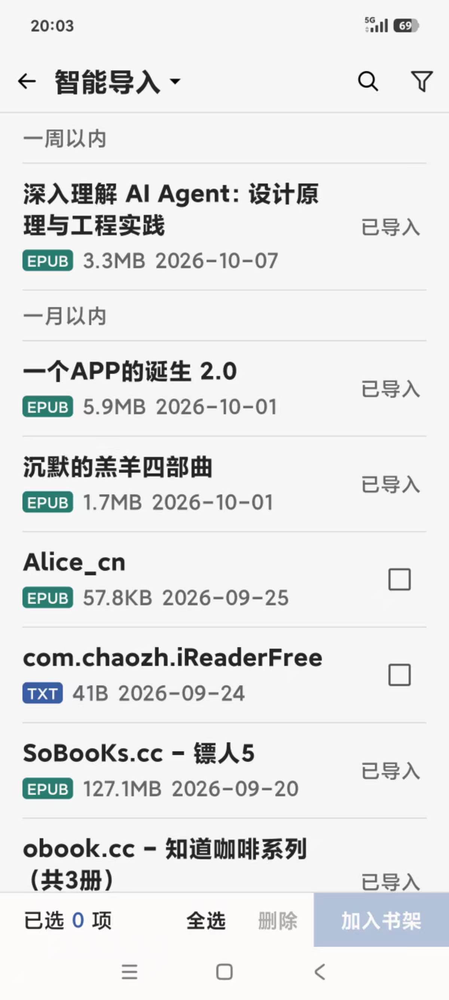
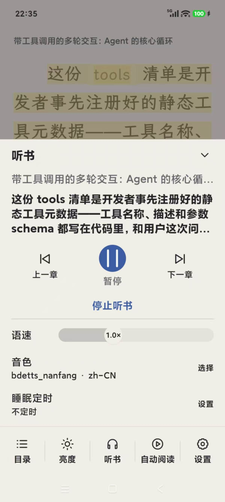
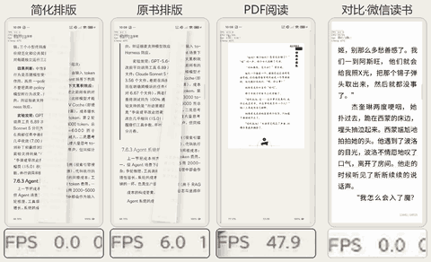
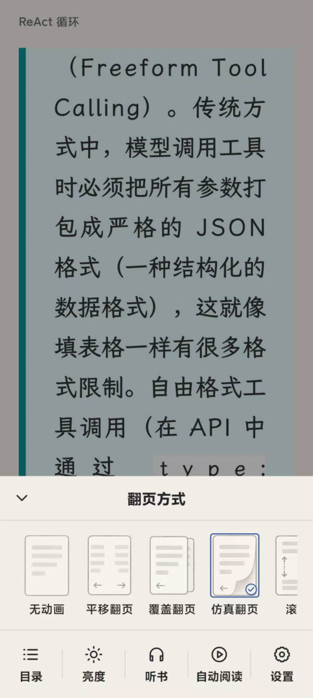

<h1 align="center">TaleTin</h1>
<p align="center"></p>

<p align="center">把故事装进口袋，把时间留给阅读。</p>

<p align="center">
  <strong>Flutter · 本地阅读 · TXT / EPUB / MOBI / AZW3 / PDF</strong>
</p>

<p align="center">
  <a href="https://flutter.dev"></a>
  <a href="LICENSE"></a>
  
</p>

<p align="center">
  <a href="#自研排版">自研排版</a> ·
  <a href="#主要特性">主要特性</a> ·
  <a href="#界面预览">界面预览</a> ·
  <a href="#翻页帧率对比">翻页帧率对比</a> ·
  <a href="#翻页动画">翻页动画</a> ·
  <a href="#开始阅读">开始阅读</a> ·
  <a href="#从源码构建">从源码构建</a> ·
  <a href="#开源协议">开源协议</a>
</p>

TaleTin 是一款专注本地阅读的跨平台阅读器，支持 TXT、EPUB、MOBI、AZW3 和 PDF。

书籍、进度、笔记和阅读统计都保存在本机，无需注册账号。应用不提供在线书城或书源，阅读内容由你自己导入。

## 自研排版

TXT、EPUB、MOBI 和 AZW3 使用 TaleTin 的自研排版引擎。还原书里的标题、配色、表格、图文布局、数学公式和字体样式。

PDF 可使用保留页面原貌的「PDF 模式」，也可切换到重新排版的「电子书模式」。

<table>
  <tr>
    <th align="center">自研排版 1</th>
    <th align="center">自研排版 2</th>
    <th align="center">自研排版 3</th>
  </tr>
  <tr>
    <td align="center">
      
    </td>
    <td align="center">
      
    </td>
    <td align="center">
      
    </td>
  </tr>
</table>

## 主要特性

| 特性 | 可以做什么 |
| --- | --- |
| **本地导入与书架** | 智能扫描或浏览文件夹，批量导入五种格式，单本文件最大 1 GB。书架支持网格或列表布局、分组、筛选和搜索。 |
| **书架分组** | 长按分组标签打开「编辑分组」，可新建、改名、删除和拖动排序。 |
| **自研排版** | 自研排版引擎采用dart+rust实现，还原书里的标题、配色、表格、图文布局、数学公式和字体样式（选择「原书字体」） |
| **PDF 双模式** | 默认显示 PDF 原页，支持 50%～500% 双指缩放、目录缩略图、大纲、书签和阅读主题。可切换到电子书模式重新排版已有文字和图片。 |
| **五种阅读方式** | 支持无动画、平移翻页、覆盖翻页、仿真翻页和滚动。 |
| **书边、横屏与双页** | 可开启纸张书边、横屏和横屏双列排版。 |
| **自定义封面** | 提供牛皮纸、武功秘籍、等八套预设，也可从系统相册选择图片。可按格式设置默认封面。 |
| **按习惯调整阅读** | 字体、字号、字重、间距、主题、亮度和翻页方式等阅读偏好全局保存。支持导入 TTF、OTF、TTC 字体，也可分别控制系统状态栏和导航栏。 |
| **阅读背景** | 电子书提供旧报纸、羊皮纸、孤舟、山水四款预设背景，也可从相册导入自定义图片。 |
| **目录、搜索与笔记** | 按章节导航，可全文搜索并跳转，下拉添加书签，长按正文可复制、加高亮或写想法。笔记可导出为 Markdown / JSON。 |
| **中英文离线查词** | 完整版中，长按正文选词后可「查词」，可离线查看读音和简体中文释义，支持中英文。 |
| **听书与自动阅读** | 调用手机已安装的系统语音引擎，选择音色、调整语速、定时停止，支持后台播放；自动阅读支持整页扫描、连续滚动。 |
| **阅读记录与成就** | 查看今日、本周与累计阅读时长，通过阅读日历回顾每天读过的书，解锁多种阅读成就。 |
| **本地备份与恢复** | 可导出/恢复书库备份，查看存储占用并清理缓存。自定义封面、阅读背景和导入的字体随书库备份保存。 |
| **问题反馈** | 遇到导入、阅读或设置异常时，可从「设置 → 数据 → 导出错误日志」保存日志，供反馈时自行选择是否提供。日志不会自动上传。 |

## 界面预览

<table>
  <tr>
    <th align="center">书架与分类</th>
    <th align="center">智能导入</th>
    <th align="center">阅读设置</th>
  </tr>
  <tr>
    <td align="center"></td>
    <td align="center"></td>
    <td align="center"></td>
  </tr>
  <tr>
    <th align="center">自研排版</th>
    <th align="center">表格显示</th>
    <th align="center">阅读记录</th>
  </tr>
  <tr>
    <td align="center"></td>
    <td align="center"></td>
    <td align="center"></td>
  </tr>
    <tr>
    <th align="center">笔记</th>
    <th align="center">听书</th>
    <th align="center">自动阅读</th>
  </tr>
  <tr>
    <td align="center"></td>
    <td align="center"></td>
    <td align="center"></td>
  </tr>
</table>


## 翻页帧率对比

这段历史实录包含旧版原书排版，用于展示当时的翻页表现。

<p align="center">
  
</p>

## 翻页动画

<table>
  <tr>
    <th align="center">五种翻页方式</th>
    <th align="center">仿真翻页</th>
    <th align="center">覆盖翻页</th>
  </tr>
  <tr>
    <td align="center"></td>
    <td align="center"></td>
    <td align="center"></td>
  </tr>
  <tr>
    <th align="center">无动画</th>
    <th align="center">平移翻页</th>
    <th align="center">滚动</th>
  </tr>
  <tr>
    <td align="center"></td>
    <td align="center"></td>
    <td align="center"></td>
  </tr>
</table>

## 开始阅读

在 [Releases](https://github.com/lolipop54/TaleTin/releases) 下载 APK，按设备架构选择 `arm64-v8a`（多数安卓手机和平板）、`armeabi-v7a`（32 位 ARM 设备）或 `x86_64`（x86_64 设备或模拟器）。

- **完整版**包含内置阅读字体和中英文离线词库。
- **基础版**的文件名带 `basic`，体积更小，省去内置阅读字体与离线词库。仍可使用系统字体、书内字体和自行导入的字体。

### 格式支持

| 格式 | 当前支持情况 |
| --- | --- |
| TXT | 使用自研排版，支持文字编码与章节识别，包括卷章合写的标题。 |
| EPUB | 可重排书籍使用自研排版，支持图片、表格、书内字体、汉字注音和脚注。 |
| MOBI / AZW3 | 支持未加密、可重排的 MOBI / KF8 / AZW3，使用自研排版。Print Replica 等特殊固定版式暂不支持。 |
| PDF | 提供 PDF 模式与电子书模式。可提取已有文字和图片，扫描页保留为图片。 |
| 固定版式 EPUB | 按单页图片顺序展示，不还原复杂的固定版面或双页拼版。 |
| 加密或带 DRM 的书籍、AZW / KFX | 当前不支持。 |

### PDF 两种模式的区别

| 能力 | PDF 模式（默认） | 电子书模式 |
| --- | --- | --- |
| 页面显示 | 保留原页的颜色、比例和版面，支持 50%～500% 缩放。可调整阅读主题 | 提取文字和图片后重新排版，可调整字体、间距、阅读主题等 |
| 导航 | 页面缩略图、原有大纲、页码和书签。 | 复用电子书的目录、进度与书签 |
| 阅读功能 | 默认支持平移翻页和连续滚动。开启「固定视图模式」后可选五种翻页方式。 | 五种翻页方式 |
| 搜索、选文、笔记、听书 | 不提供 | 仅针对实际提取到的文字进行搜索、选文或朗读 |

在 PDF 模式下，放大后可在页内自由拖动。若想固定放大区域，可在「更多设置」打开「固定视图模式」，缩放后选择「固定视图」。

### 本地数据

- 书籍、进度、笔记和阅读统计保存在本机，没有账号和云同步。更换设备、卸载或清除应用数据前，请先导出备份，并将备份保存在应用之外。
- 从应用内导入的本地书籍直接引用手机上的原文件，移动、改名或删除原文件可能使书籍失效；源文件内容变化后，应用会重新准备内容，并尝试恢复原有阅读位置、书签和笔记。
- 从书架删除书籍会清理该书的阅读数据、单书设置与应用缓存，不删除手机上的外部原文件；重新导入按新书处理。
- 听书依赖手机的系统语音引擎；音色是否支持离线使用由对应引擎决定，可断网试听确认。

## 从源码构建

当前工程面向 **Android**和**Windows**，使用 Flutter / Dart 编写界面和阅读逻辑，Kotlin 提供文件访问、系统语音与设备能力，Rust 负责 TXT 扫描及 EPUB / MOBI 正文处理，C / libmobi 负责 MOBI / AZW3 读取，PDFium 负责 PDF 原页、文字及大纲。

### 环境准备

- Flutter：当前使用 **3.47.2**。工程包含对应 Flutter 引擎的绘制补丁，请先使用该版本；升级 Flutter 时需先核对和更新补丁。
- Dart：`>=3.13.2 <4.0.0`，随 Flutter SDK 安装。
- Rust：建议沿用本项目已验证的 **1.98.1**，通过 rustup 安装，并确保 `rustc`、`cargo`、`rustup` 可在终端使用。Rust 是源码构建依赖，手机运行应用时不需要安装。

### Android 打包

Android 构建需要 Android SDK 和与当前 Gradle 兼容的 JDK。项目的 Java / Kotlin 编译目标为 17，NDK 版本由 Flutter 配置指定。

首次构建前，安装三个 Android 编译目标，并下载锁定的 Rust 依赖。在项目根目录执行：

```bash
rustup target add aarch64-linux-android armv7-linux-androideabi x86_64-linux-android
cargo fetch --locked --manifest-path tools/direct_read_rust/Cargo.toml
```

后续 Flutter 构建会通过本地依赖的构建钩子，自动调用 Cargo 和 Android NDK，编译并打包对应架构的 Rust 库及 MOBI C 库。Rust 构建使用离线模式；`Cargo.lock` 更新后需要先重新执行上面的 `cargo fetch` 命令。Windows 上如需编译本机原生库或运行 Flutter 测试，还需要 Visual Studio 的 C++ 桌面开发工具（MSVC）和 `x86_64-pc-windows-msvc` Rust 目标。

先运行 `flutter doctor`，确认 Android 工具链可用。在项目根目录执行：

```bash
flutter pub get
flutter build apk --release
```

APK 输出到 `build/app/outputs/flutter-apk/app-release.apk`。

只构建 arm64 版本，或按 CPU 架构分别打包：

```bash
# 仅 arm64
flutter build apk --release --split-per-abi --target-platform android-arm64

# 按架构生成独立 APK
flutter build apk --release --split-per-abi
```

连接 Android 设备后，也可以使用 `flutter run` 调试。

默认构建包含内置阅读字体和离线词库，排除旧的原书排版。构建资源配置与发布包一致的基础版：

```bash
flutter build apk --release --split-per-abi --dart-define=GT_INCLUDE_PRESET_FONTS=false --dart-define=GT_INCLUDE_OFFLINE_DICTIONARY=false --dart-define=GT_INCLUDE_ORIGINAL_LAYOUT=false
```

### Windows x64 打包

在 Windows x64 上安装 Visual Studio 的「使用 C++ 的桌面开发」工作负载（含 MSVC、CMake 工具和 Windows SDK），并准备 NuGet。生成安装包还需要 PowerShell 7 和 NSIS 3.13。先运行 `flutter doctor -v`，确认 Windows 和 Visual Studio 工具链可用。[Flutter Windows 环境配置](https://docs.flutter.dev/platform-integration/windows/setup)

在项目根目录用 PowerShell 执行：

```powershell
rustup target add x86_64-pc-windows-msvc
cargo fetch --locked --target x86_64-pc-windows-msvc --manifest-path tools/direct_read_rust/Cargo.toml
flutter pub get
flutter build windows --release --dart-define=GT_WINDOWS_ISOLATED_TEST_LIBRARY=false --dart-define=GT_INCLUDE_ORIGINAL_LAYOUT=false
```

Release 文件位于 `build/windows/x64/runner/Release/`。在这个目录运行 `taletin.exe` 可验证构建结果。同目录的 DLL 和 `data/` 是程序运行所需的文件。

用 [Windows 打包脚本](windows/installer/package-windows.ps1) 生成安装版和便携版。把下面两个路径替换为本机位置。VC++ 运行库目录通常在 Visual Studio 的 `VC/Redist/MSVC/<版本>/x64/Microsoft.VC143.CRT`，其中应有 `msvcp140.dll`、`vcruntime140.dll` 和 `vcruntime140_1.dll`。

```powershell
$nsisCompiler = 'C:\Program Files (x86)\NSIS\makensis.exe'
$vcRuntimeDirectory = 'C:\实际路径\Microsoft.VC143.CRT'

.\windows\installer\package-windows.ps1 `
  -NsisCompiler $nsisCompiler `
  -VcRuntimeDirectory $vcRuntimeDirectory `
  -UnsignedPreview
```

未签名预览包默认输出到 `build/deliverables/windows-<版本>+<构建号>-unsigned/`，包括 `*-Setup-unsigned.exe`、`*-Portable-unsigned.zip` 和 `SHA256SUMS.txt`。便携版完整解压到可写目录后，运行其中的 `taletin.exe`。重复打包可用 `-DeliveryDirectory` 指定新的输出目录。

生成签名包时，去掉 `-UnsignedPreview`，并传入 `-SignToolPath`、`-CertificateThumbprint` 和 `-TimestampUrl`。证书应安装在当前用户或本地计算机的「个人」证书库中，并带有可用私钥。时间戳服务需要支持 RFC 3161。

### 构建说明

- 保留 `pubspec.lock`，优先使用已锁定的依赖版本。先运行 `flutter pub get`，再按上述命令完整构建目标平台的 Release。发布构建不加 `--no-pub`，由 Flutter 重新生成对应模式的插件注册文件。
- `tools/direct_read_rust/` 和 `tools/mobi_native/` 是正式应用依赖，源码、构建钩子、生成绑定和许可必须保留；不能因为目录名是 tools 就删掉。构建方法见 [Rust 正文库说明](tools/direct_read_rust/README.md) 和 [MOBI 原生库说明](tools/mobi_native/README.md)。
- 默认构建排除原书排版的 WebView 实现、专用通道和网页资源。源码仍保留相关兼容代码，只有显式传入 `--dart-define=GT_INCLUDE_ORIGINAL_LAYOUT=true` 才会打包。请保留 [WebView 插件补丁](third_party/flutter_inappwebview_android/README.gt.md)、[导航栏补丁](third_party/curved_navigation_bar/README.gt.md) 和 [绘制补丁](android/texture_draw_patch/README.md)。
- 保留源码中的 `.g.dart`、`.g.kt` 文件及字体预览资源，按现状构建不需要先重新生成代码或字体。
- 未提供 `android/key.properties` 时，当前工程使用调试签名生成 release APK。覆盖升级必须与原安装包签名一致；自行发布时请配置并妥善保管自己的签名，密钥和密码不要提交到公开仓库。

## 反馈与参与

欢迎提issue以及fork本仓库进行修改，补充其他平台的实现。

本仓库作者尽量克服时间/财力限制，后续坚持更新。

## 致谢

TaleTin 使用了 Flutter、Riverpod、Drift、flutter_inappwebview、audio_service、Forui、libmobi、PDFium 等开源项目，感谢相关开发者的工作。完整依赖见 [pubspec.yaml](pubspec.yaml)，应用内可通过「关于 TaleTin → 查看开源许可」查看依赖许可。

## 开源协议

自 TaleTin v1.2.7 起，采用 [GNU 通用公共许可证第 3 版（GPL-3.0-only）](LICENSE)。Copyright (c) 2026 lolipop54。

GPL-3.0 允许商用和收费分发。向他人分发受 GPL-3.0 约束的应用或修改版本时，应按 GPL-3.0 向接收者提供对应源码。分发 APK 或 Windows 安装包时，应在下载位置提供对应源码的获取方式。

第三方依赖、字体及其他资源遵循各自的许可协议。MOBI 原生适配及 libmobi 使用 LGPL-3.0-or-later，相关声明见 [MOBI 许可](tools/mobi_native/LICENSE)、[libmobi 许可](tools/mobi_native/third_party/libmobi/COPYING)、[GPL 完整文本](tools/mobi_native/third_party/COPYING-GPL-3.0) 和 [miniz 许可](tools/mobi_native/third_party/MINIZ-LICENSE)；PDFium 声明见 [PDFium 许可](assets/licenses/PDFium-LICENSE.txt)。离线词库的来源与许可见 [词库来源及许可](assets/licenses/Offline-dictionary-sources.txt)。请保留这些声明及随源码提供的其他许可文件。
