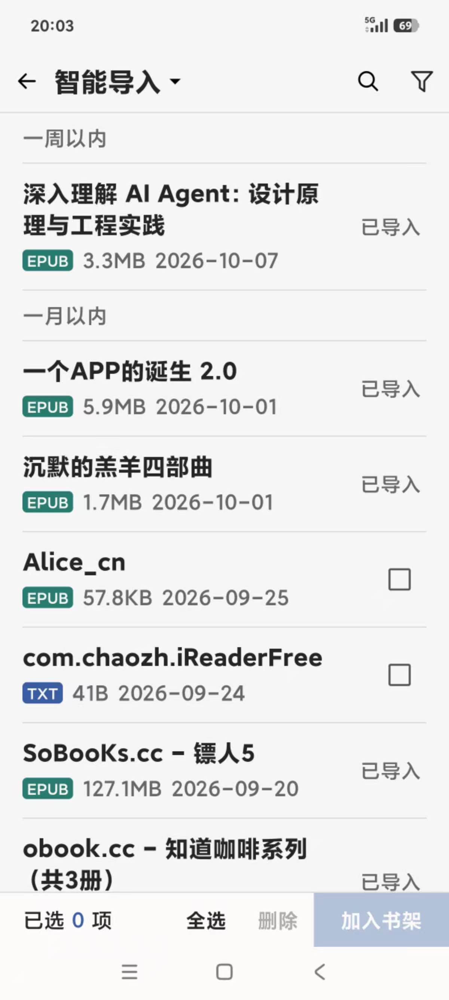
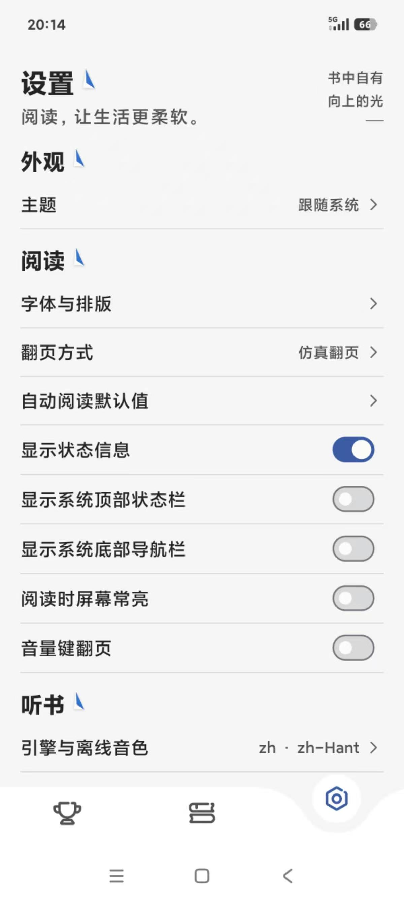
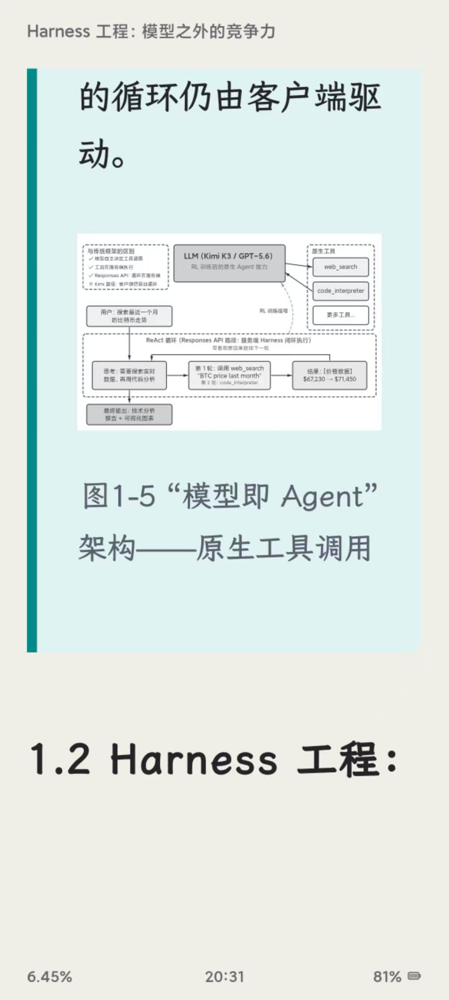
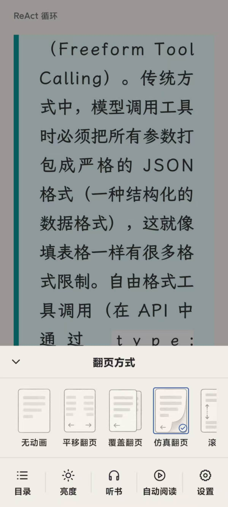

<h1 align="center">TaleTin</h1>
<p align="center"></p>

<p align="center">把故事装进口袋，把时间留给阅读。</p>

<p align="center">
  <strong>Flutter · 本地阅读 · EPUB / TXT</strong>
</p>

<p align="center">
  <a href="https://flutter.dev"></a>
  <a href="LICENSE"></a>
  
</p>

<p align="center">
  <a href="#主要特性">主要特性</a> ·
  <a href="#界面预览">界面预览</a> ·
  <a href="#翻页动画">翻页动画</a> ·
  <a href="#开始阅读">开始阅读</a> ·
  <a href="#从源码构建">从源码构建</a> ·
  <a href="#开源协议">开源协议</a>
</p>

TaleTin 是一款专注本地阅读的 Android 阅读器。导入自己的 EPUB 或 TXT，在简洁的书架中整理书籍，选择喜欢的字体、排版和翻页方式，也可以戴上耳机继续听书。

书籍、进度、笔记和阅读统计都保存在本机，无需注册账号。应用不提供在线书城或书源，阅读内容由你自己导入。

## 主要特性

| 特性 | 可以做什么 |
| --- | --- |
| **本地导入与书架** | 智能扫描或浏览文件夹，批量导入 EPUB / TXT，识别重复文件；网格与列表切换，自建分组，按在读、已读等状态筛选，搜索本地书籍。 |
| **两种 EPUB 排版** | 简化排版统一正文样式，适合专注于文字阅读；原书排版保留 EPUB 的字体、图文、表格与样式。两种模式共享阅读进度、书签和笔记。 |
| **五种翻页方式** | 无动画、平移翻页、覆盖翻页、仿真翻页、滚动，按书保存偏好；支持点按、滑动及音量键翻页。 |
| **按习惯调整阅读** | 内置多款字体，可调整字号、粗体、缩进及阅读主题；简化排版还可调整行距、段距和页边距。支持全局默认值与单书设置。 |
| **目录与全文搜索** | 按章节导航，搜索正文、查看上下文并跳转到命中位置；查看后可以回到刚才的阅读位置。 |
| **书签、高亮与想法** | 标记当前位置，长按选文、高亮并写下想法；笔记可按单书或全部书籍导出为 Markdown / JSON。 |
| **听书与自动阅读** | 调用手机的系统语音引擎，选择音色（可试听）、调整语速、定时停止，支持后台播放与锁屏控制；自动阅读提供整页扫描和连续滚动。 |
| **阅读记录与成就** | 查看今日、本周与累计阅读时长，通过阅读日历回顾每天读过的书，解锁阅读天数、时长和读完本数等成就。 |
| **本地备份与恢复** | 导出、恢复书库备份，查看存储占用并清理缓存；数据由你自己保存和管理。 |

## 界面预览

<table>
  <tr>
    <th align="center">书架与分类</th>
    <th align="center">智能导入</th>
    <th align="center">阅读设置</th>
  </tr>
  <tr>
    <td align="center"></td>
    <td align="center"></td>
    <td align="center"></td>
  </tr>
  <tr>
    <th align="center">简化排版</th>
    <th align="center">原书排版</th>
    <th align="center">表格显示</th>
  </tr>
  <tr>
    <td align="center"></td>
    <td align="center"></td>
    <td align="center"></td>
  </tr>
</table>

## 翻页动画

<table>
  <tr>
    <th align="center">五种翻页方式</th>
    <th align="center">仿真翻页</th>
    <th align="center">覆盖翻页</th>
  </tr>
  <tr>
    <td align="center"></td>
    <td align="center"></td>
    <td align="center"></td>
  </tr>
  <tr>
    <th align="center">无动画</th>
    <th align="center">平移翻页</th>
    <th align="center">滚动</th>
  </tr>
  <tr>
    <td align="center"></td>
    <td align="center"></td>
    <td align="center"></td>
  </tr>
</table>

## 开始阅读

1. 打开应用，点击 **导入书籍**，扫描或浏览本地文件，选择 EPUB / TXT 加入书架。
2. 点击书籍开始阅读，轻触正文中间区域打开控制栏。
3. 在阅读设置中选择字体、主题和翻页方式；EPUB 可切换简化排版与原书排版。
4. 长按正文添加高亮或想法，使用目录、书签与搜索定位内容。
5. 需要听书时，先在设置中选择系统语音引擎和可用音色（推荐下载MultiTTS补充音色），再从阅读控制栏开启听书。

### 格式支持

| 格式 | 当前支持情况 |
| --- | --- |
| EPUB | 支持本地导入；可重排书籍提供简化排版与原书排版。 |
| TXT | 支持本地导入、文字编码识别与章节识别，使用简化排版。 |
| 固定版式 EPUB | 按单页图片顺序展示，不提供正文重排。 |
| MOBI / AZW3 / PDF | 当前不支持。 |
| 加密或带 DRM 的书籍 | 当前不支持。 |

### 本地数据

- 应用没有账号和云同步。更换设备、卸载或清除应用数据前，请先导出备份，并将备份保存在应用之外。
- 原书排版使用 Android WebView 加载本地内容，不执行书中的脚本，也不加载外部网络资源。

## 从源码构建

当前工程面向 **Android**，使用 Flutter / Dart 编写界面和阅读逻辑，Kotlin 提供文件访问、系统语音与设备能力。

### 环境准备

- Flutter：建议先沿用本项目当前开发环境 **3.47.2**。
- Dart：`>=3.13.2 <4.0.0`，随 Flutter SDK 安装。
- Android SDK 与兼容当前 Gradle 的 JDK；Android 源码的 Java / Kotlin 编译目标为 17。

先运行 `flutter doctor`，确认 Android 工具链可用。在项目根目录执行：

```bash
flutter pub get
flutter build apk --release
```

APK 输出到 `build/app/outputs/flutter-apk/app-release.apk`。

只构建 arm64 版本，或按 CPU 架构分别打包：

```bash
# 仅 arm64
flutter build apk --release --target-platform android-arm64

# 按架构生成独立 APK
flutter build apk --release --split-per-abi
```

连接 Android 设备后，也可以使用 `flutter run` 调试。

### 构建说明

- 保留 `pubspec.lock`，优先使用已锁定的依赖版本。
- `third_party/flutter_inappwebview_android/` 是当前构建依赖的本地插件，包含 Android 构建兼容补丁，请勿删除。说明见 [插件补丁记录](third_party/flutter_inappwebview_android/README.gt.md)。
- 保留源码中的 `.g.dart`、`.g.kt` 文件及字体预览资源，按现状构建不需要先重新生成代码或字体。
- 未提供 `android/key.properties` 时，当前工程会使用调试签名生成 release APK。这种 APK 可用于自行体验，但不能覆盖安装开发者正式签名的版本；自行发布时请配置自己的签名。

## 反馈与参与

欢迎提issue以及fork本仓库进行修改，补充其他平台的实现。

项目已经处于一个较为完整可用的状态，本仓库作者由于时间/财力限制（没钱续费GPT Pro会员），后续随缘更新。

## 致谢

TaleTin 使用了 Flutter、Riverpod、Drift、flutter_inappwebview、audio_service、Forui 等开源项目，感谢相关开发者的工作。完整依赖见 [pubspec.yaml](pubspec.yaml)，应用内可通过「关于 TaleTin → 查看开源许可」查看依赖许可。

## 开源协议

本项目采用 [MIT License](LICENSE) 开源，Copyright (c) 2026 lolipop54。

第三方依赖、字体及其他资源遵循各自的许可协议。
