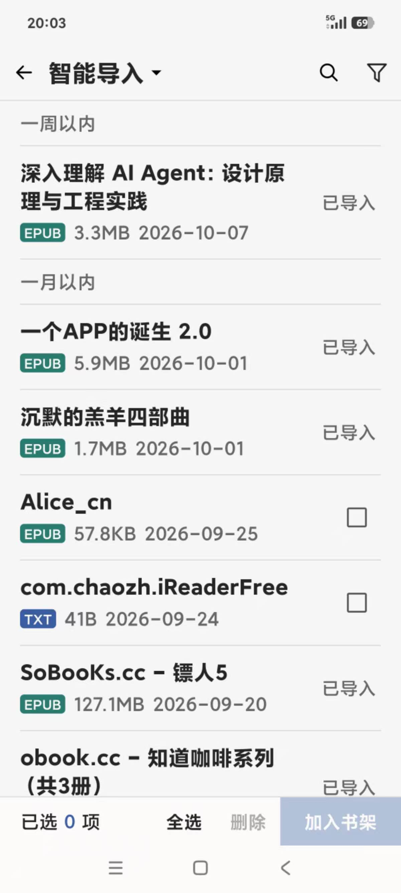
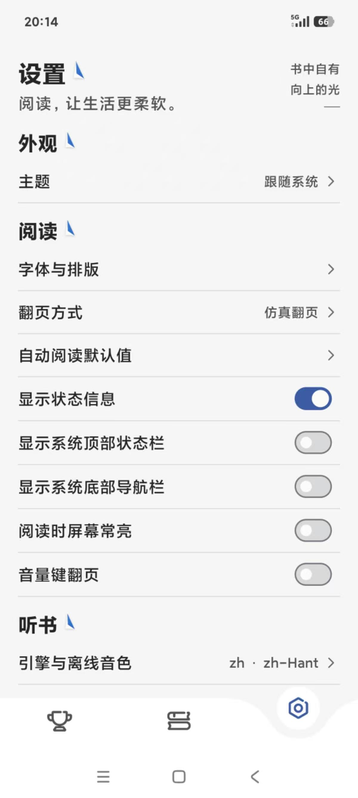
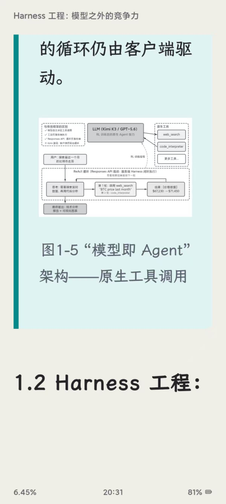
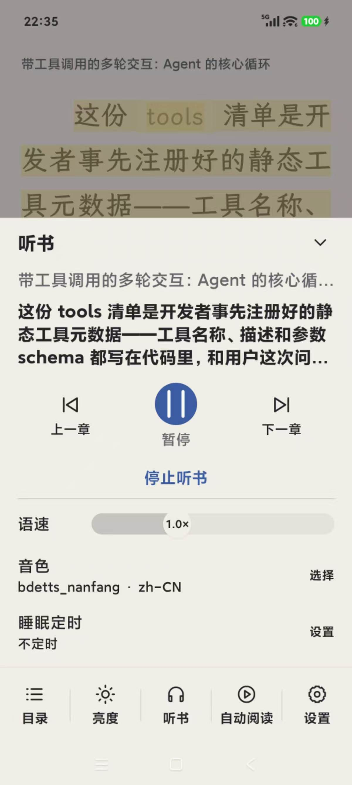
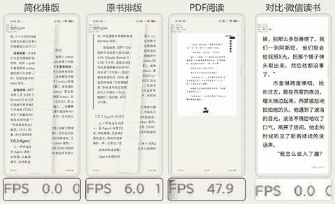
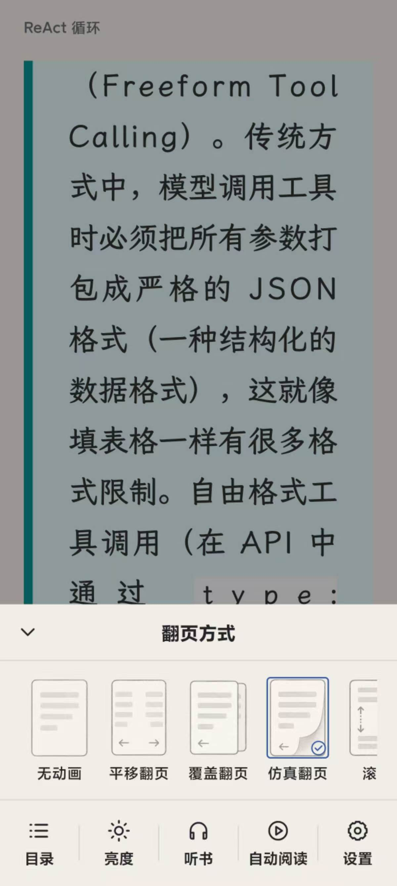
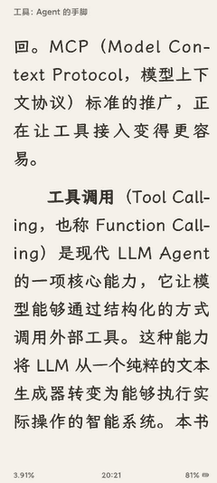

<h1 align="center">TaleTin</h1>
<p align="center"></p>

<p align="center">把故事装进口袋，把时间留给阅读。</p>

<p align="center">
  <strong>Flutter · 本地阅读 · TXT / EPUB / MOBI / AZW3 / PDF</strong>
</p>

<p align="center">
  <a href="https://flutter.dev"></a>
  <a href="LICENSE"></a>
  
</p>

<p align="center">
  <a href="#自研排版">自研排版</a> ·
  <a href="#主要特性">主要特性</a> ·
  <a href="#界面预览">界面预览</a> ·
  <a href="#翻页帧率对比">翻页帧率对比</a> ·
  <a href="#翻页动画">翻页动画</a> ·
  <a href="#开始阅读">开始阅读</a> ·
  <a href="#从源码构建">从源码构建</a> ·
  <a href="#开源协议">开源协议</a>
</p>

TaleTin 是一款专注本地阅读的 Android 阅读器，支持 TXT、EPUB、MOBI、AZW3 和 PDF。在书架中整理自己的书籍，按喜好选择字体、排版、封面和翻页方式，也可以使用手机的系统语音引擎继续听书。

书籍、进度、笔记和阅读统计都保存在本机，无需注册账号。应用不提供在线书城或书源，阅读内容由你自己导入。

## 自研排版

从 v1.2.3 起，原来的「简化排版」升级为 TaleTin 的自研排版引擎。它按屏幕宽度和你选择的字体、字号与间距重新排版，同时尽量保留书里的标题、配色、引用框、表格和图文布局，也能显示书中的数学公式。阅读 EPUB、MOBI、AZW3 时，可以选择使用书内字体。点击脚注可先预览，也可跳到注释页再返回正文。

当前版本的阅读设置中，这个模式仍显示为「简化排版」，原书排版也可以继续切换。后续计划用自研排版统一 EPUB、MOBI、AZW3 的阅读体验，并取消这三种格式的原书排版入口。

<table>
  <tr>
    <th align="center">自研排版 1</th>
    <th align="center">自研排版 2</th>
    <th align="center">自研排版 3</th>
  </tr>
  <tr>
    <td align="center">
      
    </td>
    <td align="center">
      
    </td>
    <td align="center">
      
    </td>
  </tr>
</table>

## 主要特性

| 特性 | 可以做什么 |
| --- | --- |
| **本地导入与书架** | 智能扫描或浏览文件夹，批量导入五种格式，单本文件最大 500 MiB。书架会记住网格或列表布局，支持分组、筛选和搜索。也可从文件管理器通过「打开方式」导入或续读。 |
| **自研排版** | TXT 使用自研排版，可自动识别章节。EPUB、MOBI、AZW3 可在自研排版和原书排版之间切换，两种模式共用阅读进度、书签和笔记。 |
| **PDF 双模式** | PDF 模式保留原始页面，支持缩放、缩略图、大纲、书签和阅读主题。电子书模式提取已有文字和图片后重新排版。扫描页按图片显示。 |
| **五种阅读方式** | 支持无动画、平移翻页、覆盖翻页、仿真翻页和滚动。可点按、滑动或用音量键翻页，也可在「更多设置」开启手势退出。 |
| **书边、横屏与双页** | 可开启纸张书边、横屏和横屏双页。横屏双页使用仿真翻页。PDF 原页模式也支持横屏。 |
| **自定义封面** | 提供牛皮纸、武功秘籍、远山、星河、青叶、潮汐、构成、布纹八套预设，也可从系统相册选择图片。可按格式设置默认封面，单书设置优先，并可恢复原书封面。 |
| **按习惯调整阅读** | 字体、字号、字重、间距、主题、亮度和翻页方式等阅读偏好全局保存。支持导入 TTF、OTF、TTC 字体，也可分别控制系统状态栏和导航栏。 |
| **阅读背景** | 电子书提供旧报纸、羊皮纸、孤舟、山水四款预设背景，也可从相册导入自定义图片。 |
| **目录、搜索与笔记** | 按章节导航，全文搜索并跳转，添加书签、选文高亮和想法；笔记可按单书或全部书籍导出为 Markdown / JSON。PDF原页模式提供缩略图、大纲和书签，文字功能在电子书模式中使用。 |
| **听书与自动阅读** | 调用手机已安装的系统语音引擎，选择音色、调整语速、定时停止，支持后台播放与锁屏控制；自动阅读支持整页扫描、连续滚动及双页定时翻页，运行时保持屏幕常亮。PDF 原页模式支持自动阅读，听书需切换电子书模式并有可提取文字。 |
| **阅读记录与成就** | 查看今日、本周与累计阅读时长，通过阅读日历回顾每天读过的书，解锁阅读天数、时长和读完本数等成就。 |
| **本地备份与恢复** | 导出、恢复书库备份，查看存储占用并清理缓存；自定义封面、阅读背景和导入的字体随书库备份保存。 |
| **问题反馈** | 遇到导入、阅读或设置异常时，可从「设置 → 数据 → 导出错误日志」保存日志，供反馈时自行选择是否提供。日志不会自动上传。 |

## 界面预览

<table>
  <tr>
    <th align="center">书架与分类</th>
    <th align="center">智能导入</th>
    <th align="center">阅读设置</th>
  </tr>
  <tr>
    <td align="center"></td>
    <td align="center"></td>
    <td align="center"></td>
  </tr>
  <tr>
    <th align="center">简化排版</th>
    <th align="center">原书排版</th>
    <th align="center">阅读记录</th>
  </tr>
  <tr>
    <td align="center"></td>
    <td align="center"></td>
    <td align="center"></td>
  </tr>
    <tr>
    <th align="center">笔记</th>
    <th align="center">听书</th>
    <th align="center">自动阅读</th>
  </tr>
  <tr>
    <td align="center"></td>
    <td align="center"></td>
    <td align="center"></td>
  </tr>
</table>


## 翻页帧率对比

<p align="center">
  
</p>

## 翻页动画

<table>
  <tr>
    <th align="center">五种翻页方式</th>
    <th align="center">仿真翻页</th>
    <th align="center">覆盖翻页</th>
  </tr>
  <tr>
    <td align="center"></td>
    <td align="center"></td>
    <td align="center"></td>
  </tr>
  <tr>
    <th align="center">无动画</th>
    <th align="center">平移翻页</th>
    <th align="center">滚动</th>
  </tr>
  <tr>
    <td align="center"></td>
    <td align="center"></td>
    <td align="center"></td>
  </tr>
</table>

## 开始阅读

可在 [Releases](https://github.com/lolipop54/TaleTin/releases) 下载 APK，按设备架构选择 `arm64-v8a`、`armeabi-v7a` 或 `x86_64`。文件名带 `no-preset-fonts` 的版本体积更小，仍可使用系统字体和自行导入的字体。

1. 打开应用，点击右上角导入图标，扫描或浏览本地文件，选择 TXT / EPUB / MOBI / AZW3 / PDF 加入书架。也可从文件管理器的「打开方式」选择 TaleTin。
2. 点击书籍开始阅读，轻触正文中间区域打开控制栏；已导入的书从保存的位置继续。
3. 在阅读设置中选择字体、主题和翻页方式。EPUB、MOBI、AZW3 选择「简化排版」即可使用自研排版引擎，PDF 可切换电子书模式与 PDF 模式。
4. 电子书排版可长按选文、高亮并写下想法，也可使用目录、书签和搜索定位。PDF原页可缩放查看，并通过缩略图、大纲和书签跳转。
5. 从阅读控制栏打开听书，在听书面板中选择系统语音引擎和音色。PDF 需使用电子书模式，扫描图片没有可朗读的正文。
6. 长按书架上的一本书，选择「自定义封面」更换封面；「设置 → 外观 → 自定义封面」可分别为五种格式设置默认封面。

### 格式支持

| 格式 | 当前支持情况 |
| --- | --- |
| TXT | 使用自研排版，支持文字编码与章节识别，包括缩进的章题及卷章合写的标题。 |
| EPUB | 可重排书籍提供自研排版与原书排版，支持图片、表格和书内样式。 |
| MOBI / AZW3 | 支持未加密、可重排的 MOBI / KF8 / AZW3，可选自研排版或原书排版。Print Replica 等特殊固定版式暂不支持。 |
| PDF | 提供PDF模式与电子书模式；可提取已有文字和图片，扫描页保留为图片，不进行 OCR 识别。 |
| 固定版式 EPUB | 按单页图片顺序展示，不还原复杂的固定版面或双页拼版。 |
| 加密或带 DRM 的书籍、AZW / KFX | 当前不支持。 |

### PDF 两种模式的区别

| 能力 | PDF模式 | 电子书模式 |
| --- | --- | --- |
| 页面显示 | 保留原页的颜色、比例和版面，支持缩放。阅读主题应用于原页周围的界面 | 提取文字和图片后重新排版，可调整字体和间距 |
| 导航 | 页面缩略图、原有大纲、页码和书签 | 复用电子书的目录、进度与书签 |
| 阅读功能 | 五种阅读方式、自动阅读、横屏 | 五种阅读方式、自动阅读、书边、横屏与横屏双页 |
| 搜索、选文、笔记、听书 | 不提供 | 仅针对实际提取到的文字；扫描图片不能搜索、选文或朗读 |

在阅读设置的「排版模式」中切换 PDF 模式和电子书模式。两种模式共用同一本书的阅读记录和书签，切换后从对应的位置继续阅读。

### 本地数据

- 书籍、进度、笔记和阅读统计保存在本机，没有账号和云同步。更换设备、卸载或清除应用数据前，请先导出备份，并将备份保存在应用之外。
- 从应用内导入的本地书籍直接引用手机上的原文件，移动、改名或删除原文件可能使书籍失效；源文件内容变化后，应用会重新准备内容，并尝试恢复原有阅读位置、书签和笔记。
- 从书架删除书籍会清理该书的阅读数据、单书设置与应用缓存，不删除手机上的外部原文件；重新导入按新书处理。
- 原书排版使用 Android WebView 加载本地内容，不执行书中的脚本，也不加载外部网络资源。
- 听书依赖手机的系统语音引擎；音色是否支持离线使用由对应引擎决定，可断网试听确认。

## 从源码构建

当前工程面向 **Android**，使用 Flutter / Dart 编写界面和阅读逻辑，Kotlin 提供文件访问、系统语音与设备能力，Rust 负责 TXT 扫描及 EPUB / MOBI 正文处理，C / libmobi 负责 MOBI / AZW3 读取，PDFium 负责 PDF 原页、文字及大纲。

### 环境准备

- Flutter：当前使用 **3.47.2**。工程包含对应 Flutter 引擎的绘制补丁，请先使用该版本；升级 Flutter 时需先核对和更新补丁。
- Dart：`>=3.13.2 <4.0.0`，随 Flutter SDK 安装。
- Android SDK 与兼容当前 Gradle 的 JDK；Android 源码的 Java / Kotlin 编译目标为 17。Android NDK 使用当前 Flutter 配置的版本。
- Rust：建议沿用本项目已验证的 **1.98.1**，通过 rustup 安装，并确保 `rustc`、`cargo`、`rustup` 可在终端使用。Rust 是源码构建依赖，手机运行应用时不需要安装。

首次构建前，安装三个 Android 编译目标，并下载锁定的 Rust 依赖。在项目根目录执行：

```bash
rustup target add aarch64-linux-android armv7-linux-androideabi x86_64-linux-android
cargo fetch --locked --manifest-path tools/direct_read_rust/Cargo.toml
```

后续 Flutter 构建会通过本地依赖的构建钩子，自动调用 Cargo 和 Android NDK，编译并打包对应架构的 Rust 库及 MOBI C 库，不需要手工复制 `.so` 文件。Rust 构建使用离线模式；`Cargo.lock` 更新后需要先重新执行上面的 `cargo fetch` 命令。Windows 上如需编译本机原生库或运行 Flutter 测试，还需要 Visual Studio 的 C++ 桌面开发工具（MSVC）和 `x86_64-pc-windows-msvc` Rust 目标。

先运行 `flutter doctor`，确认 Android 工具链可用。在项目根目录执行：

```bash
flutter pub get
flutter build apk --release
```

APK 输出到 `build/app/outputs/flutter-apk/app-release.apk`。

只构建 arm64 版本，或按 CPU 架构分别打包：

```bash
# 仅 arm64
flutter build apk --release --split-per-abi --target-platform android-arm64

# 按架构生成独立 APK
flutter build apk --release --split-per-abi
```

连接 Android 设备后，也可以使用 `flutter run` 调试。

排除内置字体：

```bash
flutter build apk --release --split-per-abi --dart-define=GT_INCLUDE_PRESET_FONTS=false
```

### 构建说明

- 保留 `pubspec.lock`，优先使用已锁定的依赖版本；先运行 `flutter pub get`，再使用完整的 `flutter build apk --release` 命令。发布构建不加 `--no-pub`，由 Flutter 重新生成对应模式的插件注册文件。
- `tools/direct_read_rust/` 和 `tools/mobi_native/` 是正式应用依赖，源码、构建钩子、生成绑定和许可必须保留；不能因为目录名是 tools 就删掉。构建方法见 [Rust 正文库说明](tools/direct_read_rust/README.md) 和 [MOBI 原生库说明](tools/mobi_native/README.md)。
- `third_party/flutter_inappwebview_android/`、`third_party/curved_navigation_bar/` 和 `android/texture_draw_patch/` 包含当前构建所需的补丁，请勿删除。说明见 [WebView 插件补丁](third_party/flutter_inappwebview_android/README.gt.md)、[导航栏补丁](third_party/curved_navigation_bar/README.gt.md) 和 [绘制补丁](android/texture_draw_patch/README.md)。
- 保留源码中的 `.g.dart`、`.g.kt` 文件及字体预览资源，按现状构建不需要先重新生成代码或字体。
- 未提供 `android/key.properties` 时，当前工程使用调试签名生成 release APK。覆盖升级必须与原安装包签名一致；自行发布时请配置并妥善保管自己的签名，密钥和密码不要提交到公开仓库。

## 反馈与参与

欢迎提issue以及fork本仓库进行修改，补充其他平台的实现。

项目已经处于一个较为完整可用的状态，本仓库作者由于时间/财力限制（没钱续费GPT Pro会员），后续随缘更新。

## 致谢

TaleTin 使用了 Flutter、Riverpod、Drift、flutter_inappwebview、audio_service、Forui、libmobi、PDFium 等开源项目，感谢相关开发者的工作。完整依赖见 [pubspec.yaml](pubspec.yaml)，应用内可通过「关于 TaleTin → 查看开源许可」查看依赖许可。

## 开源协议

本项目自有代码采用 [MIT License](LICENSE) 开源，Copyright (c) 2026 lolipop54。

第三方依赖、字体及其他资源遵循各自的许可协议。MOBI 原生适配及 libmobi 使用 LGPL-3.0-or-later，相关声明见 [MOBI 许可](tools/mobi_native/LICENSE)、[libmobi 许可](tools/mobi_native/third_party/libmobi/COPYING)、[GPL 完整文本](tools/mobi_native/third_party/COPYING-GPL-3.0) 和 [miniz 许可](tools/mobi_native/third_party/MINIZ-LICENSE)；PDFium 声明见 [PDFium 许可](assets/licenses/PDFium-LICENSE.txt)。请保留这些声明及随源码提供的其它许可文件。
