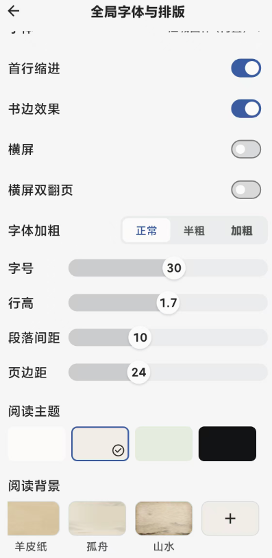
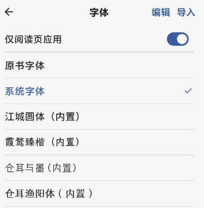

## v1.2.7 · 2026-11-25

### 新增

- 新增 Windows x64 版。可拖放导入书籍，用键盘和滚轮阅读，使用系统语音听书，也能恢复 Android 导出的整库备份。
- 自研排版支持显示全书页码。在「更多设置」的「阅读进度样式」中，可选择「页码」或「百分比」。全书页数在后台计算，边读边等。
- 听书音色列表支持按名称或语言搜索。

### 调整

- 单本书和各格式的默认封面共用同一个图库，导入一次即可重复使用。单次选择最多 9 张。
- 双列阅读固定左右页顺序，翻页、目录跳转和书签定位时，同一页会出现在同一侧。
- Android 横屏双页自动阅读也会扫描页面，先扫左页，再扫右页。
- Android 在较宽的横屏下会并排显示阅读统计和月历。
- 从全文搜索结果跳到正文后，点底部返回按钮改为回到原来的结果列表，保留关键词和浏览位置。

### 优化

- 改善 EPUB、MOBI、AZW3 的排版效果，更好地保留精排书的扉页、表格和图文布局。长表跨页时衔接更连贯，插图和图注尽量排在同一页。
- 加快复杂图文和长章节的排版，减少快速翻页和连续滚动时的停顿。
- 减少 Android 书架连续快拖时的掉帧。
- 加快智能导入的首次扫描和手动刷新速度。

### 修复

- 修复部分精排 EPUB 无法导入、目录缺章或跳转不准的问题。
- 修复部分多看 EPUB 的图片脚注点不开的问题，并扩大了小字和小图脚注的点击范围。
- 修复部分书籍遇到空章节时无法继续翻页，或误提示已到书末的问题。
- 修复部分书籍在窄屏下扉页偏移、标题或表格文字越界，以及滚动时卷首背景被截断、装饰边框断开的问题。
- 修复手机横屏时，书籍详情、自定义封面等底部面板两侧露出灰边的问题。

---

## v1.2.6 · 2026-11-15

### 新增

- 书架支持置顶书籍。
- 长按选中单本书后，可打开「书籍详情」查看封面、书名、作者、文件大小和格式，支持编辑书名与作者。
- 设置页的「关于」板块新增「更新日志」入口，可浏览近期更新日志。

### 调整

- 书架长按菜单改为两行三列，集中显示全选、分组、自定义封面、置顶、书籍详情和删除。
- 书架列表视图统一在书名下方显示作者。缺少作者信息时显示「未知作者」。

### 优化

- 优化退出书架多选时，操作菜单的收起动画。
- 统一书架「完成」、分组「排序」和书籍详情「编辑」的按钮样式为胶囊按钮。

### 修复

- 修复部分设备上书架进入多选后，滚到底有书被底部菜单遮住的问题。

---

## v1.2.5 · 2026-11-14

### 新增

- 书架页支持长按分组tab栏唤出编辑分组面板。在「移动到分组」和「编辑分组」面板中，新增可编辑分组名称的功能。
- 「更多设置」新增「图片查看」开关，默认开启。关闭后，点击图片不会打开大图。

### 调整

- 打开 PDF 默认直接显示原页（PDF模式）。仍可手动切换到电子书模式，应用会记住选择。
- 单本书的导入上限从 500 MB 提高到 1 GB。
- 在「移动到分组」面板中，把排序功能单独抽出来做成一个入口，可点击「排序」拖动调整分组顺序。
- PDF 模式调整阅读交互，双指缩放范围扩大到 50%～500%，可任意缩放并拖动，拖动到页面边缘翻页，缩放时不再锁定阅读画面；
- 原先的PDF模式阅读逻辑做成「固定视图模式」，在更多设置面板开启，该模式默认关闭。

### 优化

- 更新阅读页控制面板的「标为已读」图标，使它更清晰，并与书签、搜索图标保持一致。
- 更新阅读页控制面板顶部图标激活状态下的样式，更改为实心图标。

### 修复

- 修复部分 EPUB 在自研排版中拼音挤进正文、图片脚注过大或点不开、正文无法绕着插图排布的问题。（感谢一位b站网友的反馈）
- 修复自研排版调大字号后，单页阅读翻过几页就无法继续向前翻的问题。
- 修复部分设备打开阅读控制面板时，底部漏出阅读进度、时间和电量的问题。
- 修复大屏幕阅读时，PDF模式目录中查看到的缩略图可能显示不全的问题。

---

## v1.2.4 · 2026-11-12

### 新增

- 简化排版新增中英文离线查词。长按正文后点「查词」，即可查看读音和简体中文释义，无需联网。
- TXT 超长章节可在目录中展开小节，点击小节即可跳到对应位置。
- 「存储与缓存」新增安装包和离线词库的占用明细。
- 长按选文菜单增加「复制」选项，优先选中一个词，无法识别中文词语时选中单字。

### 调整

- **默认使用自研排版（原简化排版），原书排版已移除。**
- 点按翻页和拖动松手后的动画统一为 250 毫秒。

### 优化

- 加快 TXT 超长章节的目录跳转、进度跳转和返回原进度的速度，分页与滚动模式下都能更快看到目标正文。
- 平板横屏书架每行最多显示书籍数增加到 8 本书，列数随屏幕宽度自动调整。
- 横屏双页仿真翻页时，左右书角都能从对应角卷起，拖到屏幕另一侧时仍能跟随手指。

### 修复

- 修复部分 TXT 目录漏章、漏卷的问题，改善序章、终章、番外及不规则章标题的识别。
- 修复横屏双页中关闭大图后左右页错位的问题。在大图中滑到其他页再关闭，也会回到图片所在的正确双页。
- 修复横屏双页偶尔翻页后卡死无法继续翻页或打开阅读菜单的问题。
- 修复 Android 分屏时退出阅读页可能卡住、无法回到书架的问题。

---

## v1.2.3 · 2026-11-10

### 新增

- EPUB、MOBI、AZW3 在简化排版下也可以选择「原书字体」。
- 点击脚注可先预览内容，也可以跳到注释页，再返回原来的阅读位置。
- PDF 原页模式新增明亮、柔和、护眼、夜间四种阅读主题，PDF 页面保留原色。
- 新增手势退出阅读。开启后，分页模式可从下半屏上滑退出，滚动模式可左滑退出。

### 调整

- 字体、字号、主题、背景、亮度和翻页方式等阅读偏好统一为全局设置，在设置页或阅读页修改都会同步生效。
- 书架会记住上次使用的网格或列表布局，重启后自动恢复。
- 单本书籍的导入大小上限提高到 500 MB。
- 自动阅读期间默认保持屏幕常亮，暂停或停止后恢复正常。

### 优化

- 改善 EPUB、MOBI、AZW3 的简化排版，更好地保留原书的标题、配色、表格、引用框和图文布局，并改善数学公式的显示，**简化排版已升级为使用“自研排版”引擎（应用中仍显示为“简化排版”），由于保留两种排版需要更多的维护精力，以及对于性能的考虑，未来版本将废弃“原书排版”，使用单一的“自研排版”**。
- 减少大型 EPUB 和长章 TXT 的首次打开等待，缩短长章节翻页后等待下一次操作的时间。
- 改善大书库的加载和滚动体验。
- 阅读页打开目录时默认展开当前章节所在的分卷，搜索时更容易找到匹配章节。

### 修复

- 修复部分 TXT 目录漏章的问题。已导入的书会按需更新目录，并找回原有阅读位置、书签和笔记。
- 修复部分 EPUB、MOBI、AZW3 合集目录缺项、分卷错误或跳转位置不准的问题。
- 修复后台听书跨章后回到阅读页，继续翻页可能显示旧章节的问题。
- 修复部分情况下从通知打开阅读页后重复进入、返回书架卡住，以及后台媒体服务先启动后打开应用一直白屏的问题。

---

## v1.2.2 · 2026-10-26

### 新增

- 新增阅读背景，提供「旧报纸／羊皮纸／孤舟／山水」四款预设，可在全局设置和阅读页中选择。
- 新增相册自定义阅读背景，最多保存九张，支持长按删除，并随整库备份与恢复，导入单张图片背景的大小限制为32mb，超限会提示。

- 新增导入页手动刷新按钮：智能导入可重新扫描，手机目录可重新读取当前目录。

### 调整

- 调整书边效果，让纸张层次和明暗缝隙更清晰，并与阅读背景保持一致。

### 优化

- 优化智能导入，再次进入时可复用本次应用运行期间的扫描结果，减少重复扫描和等待。
- 优化 PDF 电子书模式的翻页准备，提前准备相邻页的文字和图片，减少翻页停顿及重复加载。

### 修复

- 修复听书被通知、导航等短暂提示音打断后，不能在系统归还音频焦点后自动继续的问题。
- 修复书架多选操作面板没考虑安全区padding的问题。
- 修复一些原书排版模式的报错。

---

## v1.2.1 · 2026-10-24

### 新增

- 新增个人字体导入，支持 TTF／OTF／TTC 格式，可通过智能扫描或手机目录批量选择，在简化排版和原书排版中使用。
- 新增字体管理，支持删除已导入字体、长按拖动调整字体顺序；排序自动保存，全局设置与阅读面板保持一致。

- 全局字体设置增加「导入」和「编辑」入口。

### 修复

- 修复隐藏顶部状态栏后，部分挖孔屏设备的阅读页面顶部仍残留黑边的问题。
- 修复关闭底部导航栏时，上滑返回桌面再进入阅读，可能出现阅读位置变化、页码或排版跳动的问题。

---

## v1.2.0 · 2026-10-24

### 新增

- 新增 MOBI／AZW3 格式支持，提供简化排版和原书排版，可使用目录、搜索、书签、笔记及听书等功能。
- 新增 PDF 阅读，提供保留原始页面的「PDF模式」和提取文字、图片重新排版的「电子书模式」。
- PDF 原页支持缩放、缩略图、大纲、书签和五种翻页方式；扫描页保留图片，不进行 OCR 识别。
- 新增书边效果、横屏和横屏双页阅读，支持全局默认和单书设置。PDF 原页模式支持横屏，书边与双页用于电子书排版。
- 新增自定义封面，提供牛皮纸、武功秘籍、远山等八套预设，也可从相册导入图片；支持单书设置和按文件格式设置默认封面。
- 新增系统「打开方式」支持，可从文件管理器打开支持格式的书籍；已导入的书直接续读，新书导入完成后自动打开。
- 新增错误日志导出，方便排查使用过程中遇到的问题。

### 调整

- 调整书架多选操作，底部集中显示全选、分组、自定义封面和删除；
- 调整封面上的格式标识，统一显示在右下角。
- 统一选文手柄样式，调整圆点大小与位置，便于查看和拖动。
- 更新桌面、启动屏及加载图标，加载动画改为柔和的亮度扫描效果。
- 完善删书清理，一并清理该书的阅读进度、笔记、单书设置和相关缓存，重新导入从新书开始；手机上的原文件不受影响。

### 优化

- 优化 MOBI／AZW3 大体积合集的导入和按需读取，减少重复处理与正文存储占用。
- 优化开书、章节读取、目录和进度跳转，减少重复处理与等待。
- 优化原书分页、滚动及翻页跟手表现，减少部分场景中的停顿。
- 优化大书库搜索和排序，以及阅读统计、成就、长目录、书签和笔记导出的批量处理，减少大量数据处理对界面操作的影响。
- 优化阅读控制面板的打开与收起，减少动画末段的停顿。

### 修复

- 修复原书排版中，中文与代码等不同字体混排时，选文手柄可能偏离文字末尾的问题。
- 修复原书排版调整字体、字号或间距后，阅读位置可能明显偏移的问题。
- 修复听书时从 锁屏解锁/后台返回前台 后没有更新页面到听书所在进度的问题。
- 修复自定义封面等底部面板被限制最大宽度的问题。
